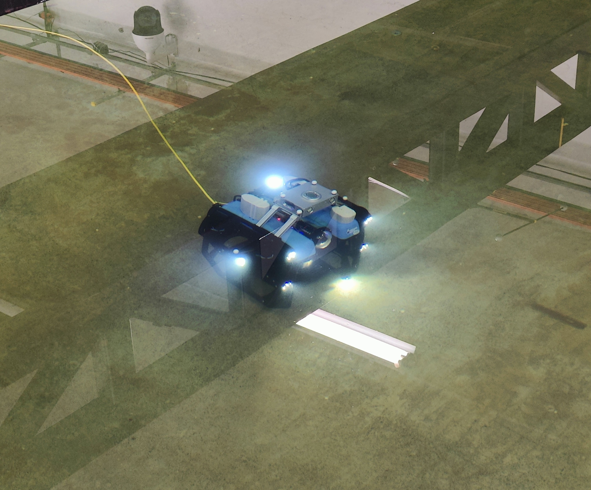
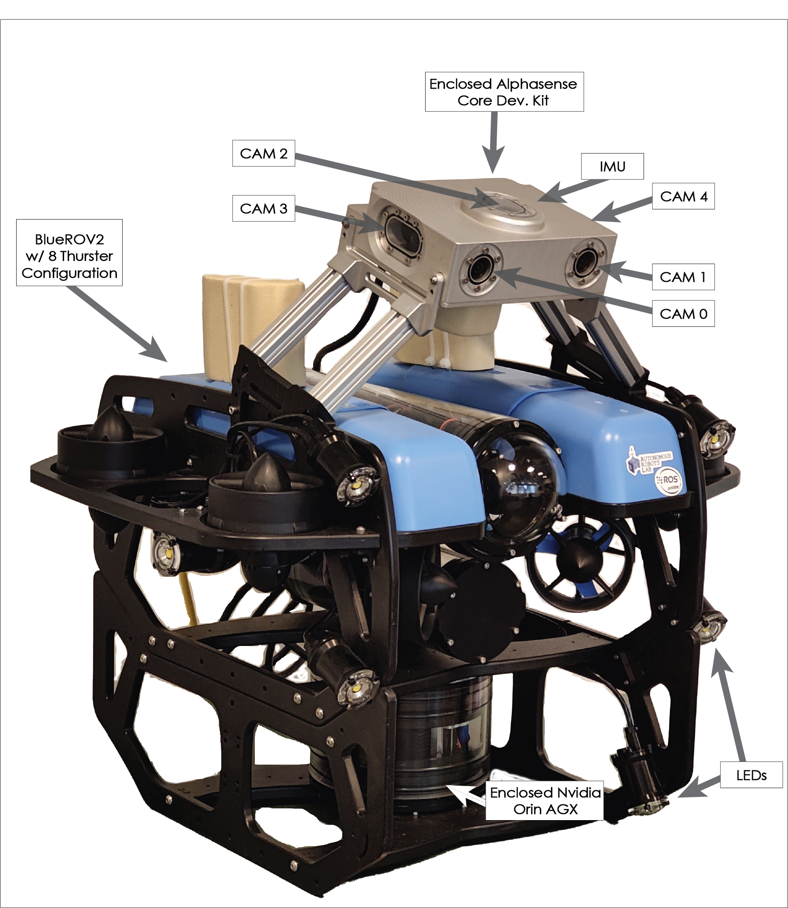

# Multi Camera Underwater Visual Inertial Dataset

[](https://opensource.org/licenses/BSD-3-Clause)

> **Data moved to Hugging Face (October 2026).** NTNU Box has been discontinued, so all download links below now point to [huggingface.co/datasets/ntnu-arl/underwater-datasets](https://huggingface.co/datasets/ntnu-arl/underwater-datasets/tree/main/mclab-2023-multicam). Each trajectory is now a single merged `.bag`, verified message-by-message against the original split recordings. The [dataset page on Hugging Face](https://huggingface.co/datasets/ntnu-arl/underwater-datasets/blob/main/mclab-2023-multicam/README.md) has the full documentation with measured durations and sizes.

## About
This is an underwater dataset
consisting of multiple onboard sensors, mainly, 5 Camera and IMU ( [Alphasense Core Research Developent Kit](https://github.com/sevensense-robotics/core_research_manual)),a Pressure Sensor, and actuator commands from an ROV piloted in an indoor facility ([MC-lab](https://www.ntnu.edu/imt/lab/cybernetics)). A total of 24 trajectories are collected with following characteristics:
* `4 Motion patterns with length 100-120m`
* `External illumination ranging from 100 to 700 lux`
* `Onboard illumination at 3 gradual levels`

Additionally, we provide trajectories with varying media (Air, Water).

## Updates / News
* **Oct 17 2026:** NTNU Box links replaced by Hugging Face links. All data, calibration and MoCap ground truth is now hosted at [huggingface.co/datasets/ntnu-arl/underwater-datasets](https://huggingface.co/datasets/ntnu-arl/underwater-datasets/tree/main/mclab-2023-multicam).
* **May 27 2024:** Added Mocap files for subset-3 in (.tum) format with artifacts removed. 
* **Apr  7 2024:** Added 6 trajectrories (2 lighing conditions x 3 motion patterns) with peicewise-continuous ground-truth from motion capture. Link: [Subset 3](https://github.com/ntnu-arl/underwater-datasets/tree/main?tab=readme-ov-file#subset-3-trajectories-with-ground-truth-from-motion-capture)
* **Nov 29 2023:** Uploaded undertwater dataset with multi-camera imu system for underwater VIO and camera models. Link: [Subset 1](https://github.com/ntnu-arl/underwater-datasets/tree/main?tab=readme-ov-file#subset-1-motion-patterns) and [Subset 2](https://github.com/ntnu-arl/underwater-datasets/tree/main?tab=readme-ov-file#subset-2-trajectories-with-varying-media-air-water)


### Varying illumination at 6 levels
| |  |  | |  | |
:-------------------------:|:-------------------------:|:-------------------------:|:-------------------------:|:-------------------------:|:-------------------------:
  |   |   |   |   |  

### 5 Camera and IMU
Cam0 | Cam1 | Cam2 | Cam3 | Cam4
:-------------------------:|:-------------------------:|:-------------------------:|:-------------------------:|:-------------------------:
  |   |   |   |   

<!-- 
This is an underwater dataset collected using an custom BlueROV (Retrofit Heavy Configuration). -->

### Ariel: Underwater robot with multi-camera imu and compute suite
Robot in water | System Description 
:-------------------------:|:-------------------------:
  |   

### Motion Patterns
| Shape | Distance Travelled (m) | Mean Linear Velocity (m/s) | Mean Angular Velocity (rad/s) |
| --- | --- | --- | --- |
| Rectangular | 120 | 0.25 | 0.12|
| Infinity | 108 | 0.45 | 0.16|
| Dumb-bell | 110 | 0.45 | 0.20|
| Dumb-bell w/ Transverse Motion | 110 | 0.25 | 0.11|


## Trajectories with Visual Inetrial Data
### Subset 1: Motion Patterns
The first subset contains 24 trajectories with 4 motion patterns and varying illumination.

Each of the trajectory contains following data in ROS bag format:

1) Camera | fps: 20Hz | resolution: 540p*720p | format: Mono8 | Topics:
```
/alphasense_driver_ros/cam0  # Front Stereo Pair: Right
/alphasense_driver_ros/cam1  # Front Stereo Pair: Left
/alphasense_driver_ros/cam2  # Top Camera
/alphasense_driver_ros/cam3  # Right Side Camera
/alphasense_driver_ros/cam4  # Left Side Camera
```
2) IMU (synced with cameras) | fps: 200Hz | Topics:
```
/alphasense_driver_ros/imu
```
3) IMU on FCU (Pixhawk) | fps: 50Hz | Topics:
```
/mavros/imu/data
```
4) Pressure Sensor | fps: 50Hz | Topics:
```
/mavros/imu/static_pressure
```
5) Actuator output PWM | fps: 50Hz | Topics:
```
/mavros/rc/out # ch 1-8 thrusters, ch 9-10 for Lumen LED
```

The collective data can be found [(1-18)](https://huggingface.co/datasets/ntnu-arl/underwater-datasets/tree/main/mclab-2023-multicam/subset-1-motion-patterns) and [(19-24)](https://huggingface.co/datasets/ntnu-arl/underwater-datasets/tree/main/mclab-2023-multicam/subset-1-motion-patterns), whereas the following table contains link to each trajectory:

### Motion Pattern 1 (Rectangular)
| Shape | Distance Travelled (m) | Mean Linear Velocity (m/s) | Mean Angular Velocity (rad/s) |
| --- | --- | --- | --- |
| Rectangular | 120 | 0.25 | 0.12|
___________

| No. | Illumination | Duration (s) | Size (Gb) | Link |
| --- | --- | --- | --- | --- |
| 1 | E0+O1 | 460  | 18.1| [link](https://huggingface.co/datasets/ntnu-arl/underwater-datasets/resolve/main/mclab-2023-multicam/subset-1-motion-patterns/traj_01/traj_01.bag)
| 2 | E0+O2 | 456 | 17.8| [link](https://huggingface.co/datasets/ntnu-arl/underwater-datasets/resolve/main/mclab-2023-multicam/subset-1-motion-patterns/traj_02/traj_02.bag)
| 3 | E0+O3 | 392 | 15.3| [link](https://huggingface.co/datasets/ntnu-arl/underwater-datasets/resolve/main/mclab-2023-multicam/subset-1-motion-patterns/traj_03/traj_03.bag)
| 4 | E1+O3 | 386 | 15.1| [link](https://huggingface.co/datasets/ntnu-arl/underwater-datasets/resolve/main/mclab-2023-multicam/subset-1-motion-patterns/traj_04/traj_04.bag)
| 5 | E1+O2 | 443 | 17.3| [link](https://huggingface.co/datasets/ntnu-arl/underwater-datasets/resolve/main/mclab-2023-multicam/subset-1-motion-patterns/traj_05/traj_05.bag)
| 6 | E1+O1 | 395 | 15.4 | [link](https://huggingface.co/datasets/ntnu-arl/underwater-datasets/resolve/main/mclab-2023-multicam/subset-1-motion-patterns/traj_06/traj_06.bag)

### Motion Pattern 2 (Infinity)
| Shape | Distance Travelled (m) | Mean Linear Velocity (m/s) | Mean Angular Velocity (rad/s) |
| --- | --- | --- | --- |
| Infinity | 108 | 0.45 | 0.16|
_____________

| No. | Illumination | Duration (s) | Size (Gb) | Link | 
| --- | --- | --- | --- | --- |
| 7 | E1+O1 | 251  | 9.8| [link](https://huggingface.co/datasets/ntnu-arl/underwater-datasets/resolve/main/mclab-2023-multicam/subset-1-motion-patterns/traj_07/traj_07.bag)
| 8 | E1+O2 | 252 | 9.8| [link](https://huggingface.co/datasets/ntnu-arl/underwater-datasets/resolve/main/mclab-2023-multicam/subset-1-motion-patterns/traj_08/traj_08.bag)
| 9 | E1+O3 | 262 | 10.2| [link](https://huggingface.co/datasets/ntnu-arl/underwater-datasets/resolve/main/mclab-2023-multicam/subset-1-motion-patterns/traj_09/traj_09.bag)
| 10 | E0+O3 | 281 | 11.0| [link](https://huggingface.co/datasets/ntnu-arl/underwater-datasets/resolve/main/mclab-2023-multicam/subset-1-motion-patterns/traj_10/traj_10.bag)
| 11 | E0+O2 | 279 | 10.9| [link](https://huggingface.co/datasets/ntnu-arl/underwater-datasets/resolve/main/mclab-2023-multicam/subset-1-motion-patterns/traj_11/traj_11.bag)
| 12 | E0+O1 | 263 | 10.2 | [link](https://huggingface.co/datasets/ntnu-arl/underwater-datasets/resolve/main/mclab-2023-multicam/subset-1-motion-patterns/traj_12/traj_12.bag)

### Motion Pattern 2 (Dumbbell)
| Shape | Distance Travelled (m) | Mean Linear Velocity (m/s) | Mean Angular Velocity (rad/s) |
| --- | --- | --- | --- |
|  Dumb-bell | 110 | 0.45 | 0.20|
_____________

| No. | Illumination | Duration (s) | Size (Gb) | Link | 
| --- | --- | --- | --- | --- |
| 13 | E0+O1| 242 |  9.8| [link](https://huggingface.co/datasets/ntnu-arl/underwater-datasets/resolve/main/mclab-2023-multicam/subset-1-motion-patterns/traj_13/traj_13.bag)
| 14 | E0+O2| 271 |  9.8| [link](https://huggingface.co/datasets/ntnu-arl/underwater-datasets/resolve/main/mclab-2023-multicam/subset-1-motion-patterns/traj_14/traj_14.bag)
| 15 | E0+O3| 138 | 10.2| [link](https://huggingface.co/datasets/ntnu-arl/underwater-datasets/resolve/main/mclab-2023-multicam/subset-1-motion-patterns/traj_15/traj_15.bag)
| 16 | E1+O3| 318 | 11.0| [link](https://huggingface.co/datasets/ntnu-arl/underwater-datasets/resolve/main/mclab-2023-multicam/subset-1-motion-patterns/traj_16/traj_16.bag)
| 17 | E1+O2| 294 | 10.9| [link](https://huggingface.co/datasets/ntnu-arl/underwater-datasets/resolve/main/mclab-2023-multicam/subset-1-motion-patterns/traj_17/traj_17.bag)
| 18 | E1+O1| 290 | 10.2| [link](https://huggingface.co/datasets/ntnu-arl/underwater-datasets/resolve/main/mclab-2023-multicam/subset-1-motion-patterns/traj_18/traj_18.bag)

### Motion Pattern 2 (Dumbbell w/ Transverse Motion)
| Shape | Distance Travelled (m) | Mean Linear Velocity (m/s) | Mean Angular Velocity (rad/s) |
| --- | --- | --- | --- |
| Dumbbell w/ Transverse Motion | 110 | 0.25 | 0.11|
_____________

| No. | Illumination | Duration (s) | Size (Gb) | Link | 
| --- | --- | --- | --- | --- |
| 19 | E1+O1| 362 |  9.8| [link](https://huggingface.co/datasets/ntnu-arl/underwater-datasets/resolve/main/mclab-2023-multicam/subset-1-motion-patterns/traj_19/traj_19.bag)
| 20 | E1+O2| 316 |  9.8| [link](https://huggingface.co/datasets/ntnu-arl/underwater-datasets/resolve/main/mclab-2023-multicam/subset-1-motion-patterns/traj_20/traj_20.bag)
| 21 | E1+O3| 365 | 10.2| [link](https://huggingface.co/datasets/ntnu-arl/underwater-datasets/resolve/main/mclab-2023-multicam/subset-1-motion-patterns/traj_21/traj_21.bag)
| 22 | E0+O3| 409 | 11.0| [link](https://huggingface.co/datasets/ntnu-arl/underwater-datasets/resolve/main/mclab-2023-multicam/subset-1-motion-patterns/traj_22/traj_22.bag)
| 23 | E0+O2| 415 | 10.9| [link](https://huggingface.co/datasets/ntnu-arl/underwater-datasets/resolve/main/mclab-2023-multicam/subset-1-motion-patterns/traj_23/traj_23.bag)
| 24 | E0+O1| 485 | 10.2| [link](https://huggingface.co/datasets/ntnu-arl/underwater-datasets/resolve/main/mclab-2023-multicam/subset-1-motion-patterns/traj_24/traj_24.bag)

**Illumination Details:** External light has two levels E0 corresponding to 100 - 300 lux and E1 corresponding to 400-700 lux measured outside and above water surface. Onboard light varies between three incremental levels, O1, O2, and O3, corresponinding to 20%, 40%, 60% pwm level of the [Lumen Subsea LED](https://bluerobotics.com/store/thrusters/lights/lumen-r2-rp/) (Max: 1500 lumens) respectively.

### Subset 2: Trajectories with Varying Media (Air, Water)
The second subset contains 6 trajectories with varying media (Air, Water).

<p align="center">
  
</p>

| Trajectory | Duration | Size | Link | 
| --- | --- | --- | --- |
| 1 |  173  | 2.6| [link](https://huggingface.co/datasets/ntnu-arl/underwater-datasets/resolve/main/mclab-2023-multicam/subset-2-varying-media/traj_01/traj_01.bag)
| 2 |  126 | 1.9| [link](https://huggingface.co/datasets/ntnu-arl/underwater-datasets/resolve/main/mclab-2023-multicam/subset-2-varying-media/traj_02/traj_02.bag)

## Camera IMU Calibration 

The cameras were calibrated using the [Kalibr](https://github.com/ethz-asl/kalibr) toolbox. The calibration data  is provided in the following table with the links for each camera intrinsics and extrinsics.

| Camera | Intrinsics (Air) | Intrinsics (Water) | Extrinsics | 
| --- | --- | --- | --- |
| cam0, cam1(Stereo Pair)| [link](https://huggingface.co/datasets/ntnu-arl/underwater-datasets/tree/main/mclab-2023-multicam/calibration/stereo_intrinsics_above_water) | [link](https://huggingface.co/datasets/ntnu-arl/underwater-datasets/tree/main/mclab-2023-multicam/calibration/stereo_intrinsics_under_water) | [link](https://huggingface.co/datasets/ntnu-arl/underwater-datasets/tree/main/mclab-2023-multicam/calibration/stereo_extrinsics_above_water)
| cam3| [link](https://huggingface.co/datasets/ntnu-arl/underwater-datasets/tree/main/mclab-2023-multicam/calibration/side_right_intrinsics_above_water) | [link](https://huggingface.co/datasets/ntnu-arl/underwater-datasets/tree/main/mclab-2023-multicam/calibration/side_right_intrinsics_underwater) | [link](https://huggingface.co/datasets/ntnu-arl/underwater-datasets/tree/main/mclab-2023-multicam/calibration/side_right_extrinsics_above_water)
| cam4| [link](https://huggingface.co/datasets/ntnu-arl/underwater-datasets/tree/main/mclab-2023-multicam/calibration/side_left_intrinsics_above_water) | [link](https://huggingface.co/datasets/ntnu-arl/underwater-datasets/tree/main/mclab-2023-multicam/calibration/side_left_intrinsics_under_water) | [link](https://huggingface.co/datasets/ntnu-arl/underwater-datasets/tree/main/mclab-2023-multicam/calibration/side_left_extrisics_above_water)

### Subset 3: Trajectories with Ground-truth from Motion Capture
 


| No. | Illumination | Duration (s) | Size (Gb) | Motion Pattern | Link | MoCap Ground-Truth (.tum) |
| --- | --- | --- | --- | --- | --- | --- |
| 1 | E1+O1| 370 |  14.5| Rectangular | [link](https://huggingface.co/datasets/ntnu-arl/underwater-datasets/resolve/main/mclab-2023-multicam/subset-3-mocap-gt/traj_01/traj_01.bag) | [link](https://huggingface.co/datasets/ntnu-arl/underwater-datasets/resolve/main/mclab-2023-multicam/subset-3-mocap-gt/traj_01/traj_01_mocap.tum)
| 2 | E1+O1| 374 |  14.7| Infinity/Figure "8" | [link](https://huggingface.co/datasets/ntnu-arl/underwater-datasets/resolve/main/mclab-2023-multicam/subset-3-mocap-gt/traj_02/traj_02.bag)  | [link](https://huggingface.co/datasets/ntnu-arl/underwater-datasets/resolve/main/mclab-2023-multicam/subset-3-mocap-gt/traj_02/traj_02_mocap.tum)
| 3 | E1+O1| 318 | 12.5| Dumbbell | [link](https://huggingface.co/datasets/ntnu-arl/underwater-datasets/resolve/main/mclab-2023-multicam/subset-3-mocap-gt/traj_03/traj_03.bag)  | [link](https://huggingface.co/datasets/ntnu-arl/underwater-datasets/resolve/main/mclab-2023-multicam/subset-3-mocap-gt/traj_03/traj_03_mocap.tum)
| 4 | E0+O1| 405 | 15.9| Rectangular | [link](https://huggingface.co/datasets/ntnu-arl/underwater-datasets/resolve/main/mclab-2023-multicam/subset-3-mocap-gt/traj_04/traj_04.bag)  | [link](https://huggingface.co/datasets/ntnu-arl/underwater-datasets/resolve/main/mclab-2023-multicam/subset-3-mocap-gt/traj_04/traj_04_mocap.tum)
| 5 | E0+O1| 401 | 15.7| Infinity/Figure "8" | [link](https://huggingface.co/datasets/ntnu-arl/underwater-datasets/resolve/main/mclab-2023-multicam/subset-3-mocap-gt/traj_05/traj_05.bag)  | [link](https://huggingface.co/datasets/ntnu-arl/underwater-datasets/resolve/main/mclab-2023-multicam/subset-3-mocap-gt/traj_05/traj_05_mocap.tum)
| 6 | E0+O1| 302 | 11.6| Dumbbell | [link](https://huggingface.co/datasets/ntnu-arl/underwater-datasets/resolve/main/mclab-2023-multicam/subset-3-mocap-gt/traj_06/traj_06.bag)  | [link](https://huggingface.co/datasets/ntnu-arl/underwater-datasets/resolve/main/mclab-2023-multicam/subset-3-mocap-gt/traj_06/traj_06_mocap.tum)

## Reference
If you use this work in your research, please cite the publications as follows:

[An Online Self-calibrating Refractive Camera Model with Application to Underwater Odometry](https://arxiv.org/abs/2310.16658)
```
@misc{singh2023online,
      title={An Online Self-calibrating Refractive Camera Model with Application to Underwater Odometry}, 
      author={Mohit Singh and Mihir Dharmadhikari and Kostas Alexis},
      year={2023},
      eprint={2310.16658},
      archivePrefix={arXiv},
      primaryClass={cs.RO}
}
```

## Contact
You can contact us for any question:
* [Mohit Singh](mailto:mohit.singh@ntnu.no)
* [Mihir Dharmadhikari](mailto:mihir.dharmadhikari@ntnu.no)
* [Kostas Alexis](mailto:konstantinos.alexis@ntnu.no)
